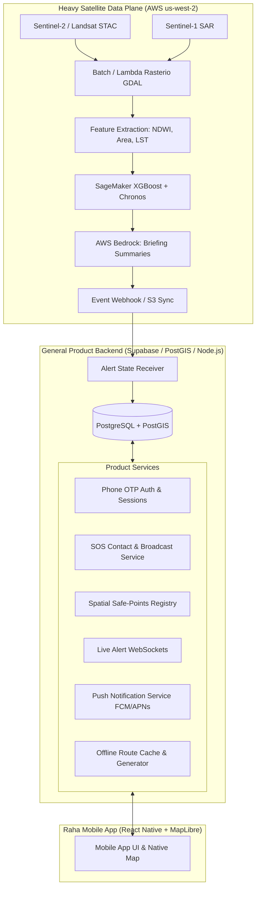

# Architectural Plan: High-Performance Vector Maps & Decoupled Product Backend

This document details the technical implementation plan for **Raha (Glacial Threat Early Warning System)** based on **PRD v2.0**, specifically addressing:
1. **Google Maps-grade map performance** without commercial API fees using **MapLibre Native** (explaining why Leaflet/OSM fails and how MapLibre delivers fluid 60/120fps native gestures).
2. **Backend Architecture & Workload Minimization on AWS**: Decoupling the heavy satellite/ML data pipeline from a lightweight, developer-friendly **General Product Backend** for Phone Auth, SOS, User Profiles, Safe Points, Realtime Subscriptions, and Push Notifications.

---

## 1. Map Architecture: Achieving 1:1 Google Maps Parity with MapLibre

### 1.1 The Core Problem with Leaflet & OSM WebViews on Mobile
Leaflet and browser-based OpenStreetMap viewers are designed for desktop DOM environments. When embedded in React Native via `react-native-webview`:
- **The Double-Bridge Latency**: Touch gestures (pan, pinch, double-tap) must travel:
  $$\text{Native Touch Driver} \longrightarrow \text{RN Native Thread} \longrightarrow \text{JS Bridge} \longrightarrow \text{WebView IPC} \longrightarrow \text{DOM Event}$$
  This introduces **60–120ms input lag**, causing rubber-banding, stutter, and dropped frames.
- **Raster Tile "Stepping" & Popping**: Standard Leaflet uses pre-rendered 256×256 pixel PNG raster tiles. During a pinch-to-zoom gesture, tiles stretch and blur before snapping to the next discrete zoom level ($z=12 \to z=13$), causing severe visual jarring and white tile flashing.
- **No Vector Label Collision or 3D Pitch**: Text labels rotate awkwardly with the map or get clipped, and the map cannot be smoothly pitched/tilted for 3D mountain topography.
- **Memory Footprint**: Running a headless Chromium/WebKit instance inside React Native consumes 80–150MB extra RAM, which is dangerous on low-end Android devices during an emergency evacuation.

### 1.2 Why MapLibre Native (`@maplibre/maplibre-react-native`) Matches Google Maps
`@maplibre/maplibre-react-native` is the open-source fork of Mapbox GL Native. It is **not a WebView**; it is a **compiled C++ rendering engine with native Metal (iOS) and OpenGL ES / Vulkan (Android) backends**.

| Feature | Leaflet (WebView) | Google Maps SDK | MapLibre Native |
| :--- | :--- | :--- | :--- |
| **Rendering Engine** | WebKit DOM / Canvas | Native GPU (Metal/Vulkan) | **Native GPU (Metal/OpenGL/Vulkan)** |
| **Gesture Frame Rate** | 24–35 fps (Janky) | 60 / 120 fps (ProMotion fluid) | **60 / 120 fps (Native UI Thread)** |
| **Zoom Dynamics** | Discrete integer steps ($z$) | Continuous fractional ($z=14.32$) | **Continuous fractional ($z=14.32$)** |
| **Tile Format** | 256px Raster PNG | Proprietary Vector Vector Protocol | **Mapbox Vector Tiles (MVT / Protobuf)** |
| **Label Collision** | Static DOM overlays | Dynamic real-time GPU engine | **Dynamic real-time GPU collision detection** |
| **Offline Vector Caching** | Primitive localStorage | Limited offline areas | **Full native offline tile packs (`offlineManager`)** |
| **Commercial API Cost** | Free (slow) | **$7.00 per 1,000 map loads** | **$0.00 (Self-hosted or OpenFreeMap)** |
| **Custom Hazard Overlays** | Slow DOM SVG/Canvas | GeoJSON/Polygons (limited styling) | **Hardware-accelerated shader layers** |

### 1.3 Zero-Cost Vector Tile Provider Strategy
To run MapLibre completely free while matching Google Maps cartographic quality:

1. **Option A (Recommended for Development & Zero-Config): OpenFreeMap**
   - 100% free, open-source vector tile service hosted on Cloudflare with global edge caching.
   - Zero API keys, zero rate limits, full support for `bright`, `liberty`, and `positron` styles.
   - Direct drop-in tile style URL: `https://tiles.openfreemap.org/styles/liberty`
2. **Option B (Recommended for Production & Offline Zero-Egress): Protomaps / PMTiles on S3 + CloudFront**
   - Extract vector tiles for target Himalayan basins (Nepal, Sikkim, Koshi, Bihar) into a single `.pmtiles` file (~150MB total).
   - CloudFront serves HTTP Range Requests directly from S3.
   - Cost: **<\$0.50/month** total for millions of tile requests.
3. **Option C: Amazon Location Service (PRD Section 15)**
   - Fully supported by MapLibre using AWS Cognito credentials or API keys with Esri/HERE styles. Incurs ~$0.04/1000 requests.

### 1.4 Dynamic Hazard Layers & Cartography
In Raha, the map must display critical hazard context over the basemap:
- **Downstream Inundation Zones**: Rendered as `<MapLibreGL.FillLayer>` with data-driven styling matching PRD tokens (`#D9622B` for Warning, `#D12F2F` for Evacuate).
- **River Trunk Bed (Dudh Koshi & Teesta)**: Rendered via `<MapLibreGL.LineLayer>` with smooth Bézier curvature.
- **Glacial Lake Outlines (Imja Tsho, Tsho Rolpa, South Lhonak)**: Pulsing polygon border shaders using MapLibre expressions.
- **Safe Points & Evacuation Ridge Routes**: Rendered as interactive `<MapLibreGL.SymbolLayer>` with elevation badge icons and teal pathway lines (`#1BA6A0`).

### 1.5 Offline First Architecture (PRD FR-14)
- When a user registers their coarse home zone (e.g. Namche Bazaar or Chungthang), the app triggers `MapLibreGL.offlineManager.createPack()`.
- Pre-downloads:
  1. Vector basemap tiles (Zoom levels 8 to 15 for a 25km radius).
  2. Safe point geometries and precomputed ridge escape routes.
  3. Style glyphs and sprites.
- If cellular towers lose power during a flood outburst, the user's map renders with full pan/zoom functionality offline.

---

## 2. Decoupled Backend Architecture: Minimizing AWS Workload

### 2.1 The Problem with 100% AWS for Mobile Product Features
The PRD outlines two distinct operational planes:
- **Data Plane (us-west-2)**: Satellite scene discovery, raster processing, ML feature extraction, Bedrock LLM generation.
- **Product Plane (ap-south-1)**: Mobile API, user auth, SOS contacts, safe points, notifications.

Putting 100% of the Product Plane on AWS (Cognito Custom SMS OTP, AppSync GraphQL with VTL/JS resolvers, DynamoDB single-table design, SNS Platform applications) creates excessive complexity:
- AWS Cognito phone auth requires custom Lambda hooks (`CreateAuthChallenge`, `VerifyAuthChallenge`) and is notoriously tricky to debug locally.
- AWS SNS for SMS in India requires strict TRAI DLT sender ID and template approvals, with sandbox limits.
- AppSync GraphQL schema maintenance adds heavy boilerplate for standard CRUD operations.

### 2.2 Optimal Workload Split: 2-Tier Architecture



### 2.3 Feature-by-Feature Allocation Matrix

| PRD Req | Feature Description | Target Backend | Rationale & Technology |
| :--- | :--- | :--- | :--- |
| **FR-1 - FR-3** | Satellite Scene Ingestion & Raster Processing | **AWS (us-west-2)** | Zero-egress direct S3 access to Sentinel/Landsat COG buckets, GDAL/rasterio containers. |
| **FR-4** | Risk Forecasting & ML Inference | **AWS (us-west-2)** | SageMaker Chronos / XGBoost + Bedrock for plain-language briefing generation. |
| **FR-10** | Phone Number Sign-in with OTP | **General Backend** | Supabase Auth / Twilio Verify / Msg91 OTP: 1-click setup, avoids complex Cognito SMS Lambdas. |
| **FR-10** | User Profile, Language & Consent | **General Backend** | Standard relational tables with Row Level Security (RLS) complying with India's DPDP Act 2023. |
| **FR-11** | Home & Profile Screens Data | **General Backend** | Simple REST / JSON endpoints cached with TanStack Query. |
| **FR-12** | Safe Points & High Ground Registry | **General Backend** | **PostGIS** spatial database (`ST_DWithin`, `ST_Distance`) to instantly query nearest shelters ranked by travel time. |
| **FR-12** | SOS Contacts & Emergency Broadcast | **General Backend** | Ingestion of emergency SOS alerts, fan-out to contacts via SMS gateway + Push. |
| **FR-13** | Navigation & Hazard Avoidance Routing | **General Backend + Client** | GraphHopper / OSRM / PostGIS `pgRouting` or Turf.js client-side precomputed route cache. |
| **FR-14** | Offline Map & Evacuation Cache | **General Backend (CDN)** | Serves pre-packaged vector tiles and evacuation routes for offline caching. |
| **FR-15** | Demo Scenario Switch (Clear $\to$ Evacuate) | **General Backend** | Lightweight authenticated POST endpoint to flip state machine without waiting for satellite passes. |
| **FR-6** | Push Notifications | **General Backend** | Firebase Cloud Messaging (FCM) & APNs via OneSignal/Expo Push (avoids SNS platform complexity). |
| **FR-6** | Mass Emergency SMS Dispatch | **AWS SNS or Dedicated Gateway** | Multi-channel: AWS SNS or dedicated Indian SMS provider (Msg91/Exotel with DLT templates). |
| **FR-16** | Operator & Authority Web Dashboard | **General Backend** | Simple Next.js / Vite web console querying the same PostgreSQL database. |

### 2.4 General Backend Data Model (PostgreSQL / Supabase Schema)
Instead of an intricate DynamoDB single-table design, a clean relational schema with spatial indices:

```sql
-- 1. Profiles & Consent
CREATE TABLE profiles (
    id UUID PRIMARY KEY REFERENCES auth.users(id),
    phone_number TEXT UNIQUE NOT NULL,
    language TEXT DEFAULT 'en', -- en, hi, ne
    home_zone_id TEXT REFERENCES zones(id),
    consent_flags JSONB DEFAULT '{"emergency_sms": true, "location_tracking": false}',
    created_at TIMESTAMPTZ DEFAULT NOW()
);

-- 2. SOS Contacts (up to 5 per user)
CREATE TABLE sos_contacts (
    id UUID PRIMARY KEY DEFAULT gen_random_uuid(),
    user_id UUID REFERENCES profiles(id) ON DELETE CASCADE,
    name TEXT NOT NULL,
    phone_number TEXT NOT NULL,
    relationship TEXT NOT NULL, -- Family, Friend, Neighbor
    notify_at_risk BOOLEAN DEFAULT TRUE,
    opt_in_status TEXT DEFAULT 'CONFIRMED' -- PENDING, CONFIRMED, OPTED_OUT
);

-- 3. Glacial Lakes & Zones
CREATE TABLE lakes (
    id TEXT PRIMARY KEY, -- 'imja-tsho', 'tsho-rolpa', 'south-lhonak'
    name TEXT NOT NULL,
    basin TEXT NOT NULL,
    coordinates GEOMETRY(Point, 4326),
    elevation_m INT
);

CREATE TABLE zones (
    id TEXT PRIMARY KEY, -- 'namche-zone-1', 'chungthang-core'
    lake_id TEXT REFERENCES lakes(id),
    name TEXT NOT NULL,
    geometry GEOMETRY(Polygon, 4326), -- Inundation polygon
    arrival_window_min INT, -- Minutes from breach to first wave
    arrival_window_max INT
);

-- 4. Safe Points / High Ground Shelters (PostGIS Indexed)
CREATE TABLE safe_points (
    id TEXT PRIMARY KEY,
    zone_id TEXT REFERENCES zones(id),
    name TEXT NOT NULL,
    type TEXT NOT NULL, -- 'RIDGE_SHELTER', 'HEALTH_POST', 'HIGH_GROUND', 'COMMUNITY_CENTER'
    location GEOMETRY(Point, 4326) NOT NULL,
    elevation_m INT NOT NULL,
    elevation_gain_m INT NOT NULL,
    capacity INT NOT NULL,
    contact_phone TEXT
);
CREATE INDEX idx_safepoints_geo ON safe_points USING GIST(location);

-- 5. Realtime Assessments (Updated from AWS ML Webhook)
CREATE TABLE lake_assessments (
    id UUID PRIMARY KEY DEFAULT gen_random_uuid(),
    lake_id TEXT REFERENCES lakes(id),
    alert_level TEXT NOT NULL, -- 'CLEAR', 'WATCH', 'WARNING', 'EVACUATE'
    window_hours TEXT NOT NULL,
    contributing_factors TEXT[] NOT NULL,
    summary_text TEXT NOT NULL, -- Plain language from Bedrock
    data_age_min INT NOT NULL,
    model_version TEXT NOT NULL,
    created_at TIMESTAMPTZ DEFAULT NOW()
);

-- 6. Emergency SOS Dispatches & Audit Logs
CREATE TABLE sos_events (
    id UUID PRIMARY KEY DEFAULT gen_random_uuid(),
    user_id UUID REFERENCES profiles(id),
    location GEOMETRY(Point, 4326),
    battery_level INT,
    status TEXT DEFAULT 'DISPATCHED', -- DISPATCHED, DELIVERED, RESOLVED
    created_at TIMESTAMPTZ DEFAULT NOW()
);
```

---

## 3. High-Priority Implementation Roadmap

### Phase 1: Native MapLibre Integration in Expo App
1. **Dependency Setup**:
   - Add `@maplibre/maplibre-react-native` and its Expo Config Plugin.
   - Verify compatibility with Expo SDK 57 / React Native 0.86 New Architecture.
2. **Component Architecture**:
   - Create a clean `NativeHazardMapView` component wrapping MapLibre.
   - Configure vector style using OpenFreeMap / PMTiles style JSON.
   - Implement dynamic `<ShapeSource>` and `<FillLayer>` for hazard zones.
   - Implement `<LineLayer>` for safe escape ridge routes.
   - Add custom HTML/native marker callouts for safe shelters.
3. **Smooth Gestures & Interactions**:
   - Enable continuous pinch-to-zoom and inertial panning on native UI thread.
   - Connect camera animated bounds (`cameraRef.setCamera(...)`) to lake and user locations.
4. **Offline Pack Pre-caching**:
   - Implement download manager hook for offline tile packages around user's home zone.

### Phase 2: Decoupled Product Backend Setup
1. **Backend Initialization**:
   - Initialize PostgreSQL + PostGIS instance (e.g. Supabase or standalone PostGIS container).
   - Configure Auth provider for Phone OTP.
2. **API & Realtime Client (`src/services/api.ts`)**:
   - Replace the mock client with a real client querying the Product Backend.
   - Add WebSocket listener (`supabase.channel('alert-changes')` or standard WebSocket) to update Zustand `activeAssessment` in real-time.
3. **AWS Data Plane Bridge**:
   - Create a simple secure webhook endpoint (`POST /api/internal/assessment-sync`) authenticated via API secret.
   - When AWS Step Functions / SageMaker completes an assessment run, it posts the output to this endpoint, triggering immediate mobile WebSocket push.

### Phase 3: Safety-Critical Evacuation Routing
1. **Precomputed Offline Topological Routes**:
   - Store verified uphill escape routes in GeoJSON format per zone.
   - Cache locally inside SQLite / MMKV so the app never fails even if offline.
2. **Hazard Avoidance Engine**:
   - If user searches A-to-B navigation, test route geometry against active `WARNING` or `EVACUATE` polygons.
   - Auto-divert users around valley flow lines.

---

## 4. Verification & Testing Plan

### Automated Checks
- **Type Checking & Linting**: `npx tsc --noEmit` and `npx expo lint`.
- **MapLibre Config Plugin Validation**: `npx expo config --type introspect` to verify native build properties.
- **Offline Pack Unit Tests**: Test download progress callbacks and offline fallback states.

### Manual Verification
- **Gesture Fluidity Test**: Verify 60/120fps gesture response with no latency on iOS simulator & Android device.
- **Offline Simulation**: Toggle device Airplane mode and confirm map tiles, safe points, and escape routes remain fully visible.
- **Demo State Flipping**: Test the home screen demo switch from Clear to Evacuate and verify the map immediately paints the red hazard inundation polygon and highlights the nearest safe point.
